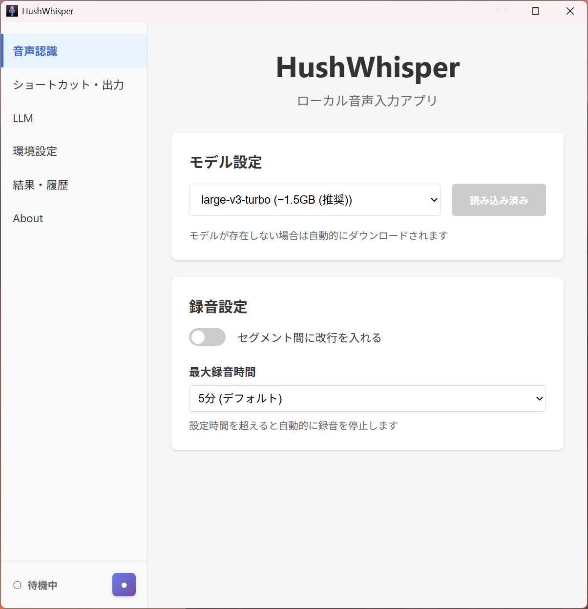

# HushWhisper

Windows 向けローカル音声入力アプリ。グローバルショートカットで任意のアプリに日本語音声入力。

## 主要機能

- グローバルショートカットで任意のアプリ上に音声入力
- 音声認識（Whisper / CUDA による GPU 推論）
- Silero VAD による無音区間の除去（誤認識防止）
- LLM による文章整形（Ollama / LM Studio 等の OpenAI 互換 API 対応、カスタマイズ可能）
- 完全ローカル処理（クラウド不要）
- システムトレイに常駐
- 履歴保存
- Windows 起動時の自動起動

## 対応 OS

- Windows 10 (1809 / build 17763) 以降

## インストール

1. [リリース](https://github.com/hushin/hush-whisper/releases) から配布物をダウンロード
2. 任意のフォルダに展開し `HushWhisper.exe` を実行

> 本アプリは Windows App SDK のセルフコンテインメント配布のため、
> Windows App SDK ランタイムの別途インストールは不要です。

## 使い方

1. アプリを起動
2. 「音声認識」で Whisper モデルを選択し、「モデルを読み込む」をクリック（初回は自動ダウンロード）
3. ショートカット（既定: `Ctrl+Space`）を押して録音開始
4. もう一度押して録音停止
5. 認識結果がクリップボードにコピー / カーソル位置に貼り付けられる

## スクリーンショット



## 技術スタック

- **Framework**: WinUI 3 / Windows App SDK (C# / .NET 9)
- **UI パターン**: MVVM (CommunityToolkit.Mvvm) + 依存性注入 (Microsoft.Extensions.DependencyInjection)
- **Speech Recognition**: Whisper.net (whisper.cpp bindings, CUDA 13 / 12 / Vulkan / CPU を自動選択)
- **VAD**: Whisper.net 内蔵 Silero VAD (ggml)
- **Audio**: NAudio (WASAPI キャプチャ + リサンプリング)
- **Clipboard / Paste**: Win32 API (クリップボード + `SendInput`)
- **Global Shortcut**: Win32 `RegisterHotKey`
- **Tray**: H.NotifyIcon.WinUI
- **LLM**: Ollama / OpenAI 互換 API (HTTP)

詳細は [`docs/tech-stack.md`](docs/tech-stack.md) を参照。

## 開発環境セットアップ

### 必要な環境

- .NET 9 SDK
- (CUDA を使う場合) NVIDIA GPU + CUDA 12.x / 13.x ドライバー

Visual Studio は必須ではありません（`dotnet` CLI でビルド可能）。IDE を使う場合は
Visual Studio 2026 + 「WinUI application development」ワークロードを推奨します。

### ビルド / 実行

```powershell
# ビルド
dotnet build HushWhisper\HushWhisper.csproj -c Debug -p:Platform=x64

# 実行
dotnet run --project HushWhisper\HushWhisper.csproj -c Debug -p:Platform=x64

# リリースビルド（自己完結 / x64）
dotnet publish HushWhisper\HushWhisper.csproj -c Release -r win-x64 -p:Platform=x64
```

## ディレクトリ構造

```
HushWhisper/
  App.xaml(.cs)          # エントリポイント + DI 構成
  MainWindow.xaml(.cs)   # Mica + NavigationView シェル / トレイ / ホットキー
  Interop/               # Win32 P/Invoke
  Models/                # 設定・モデル定義・ログ型
  Services/              # 音声・ASR・VAD・LLM・出力・ホットキー・トレイ・ログ 等
  ViewModels/            # 各ページの ViewModel
  Views/                 # 各設定ページ (XAML)
  Assets/                # アイコン
docs/                    # 実装計画・詳細
```

設定ファイル: `%APPDATA%\voice-input\config.json`
モデル: `%APPDATA%\voice-input\models\`
ログ: `%APPDATA%\voice-input\logs\`

## License

[MIT](LICENSE)
